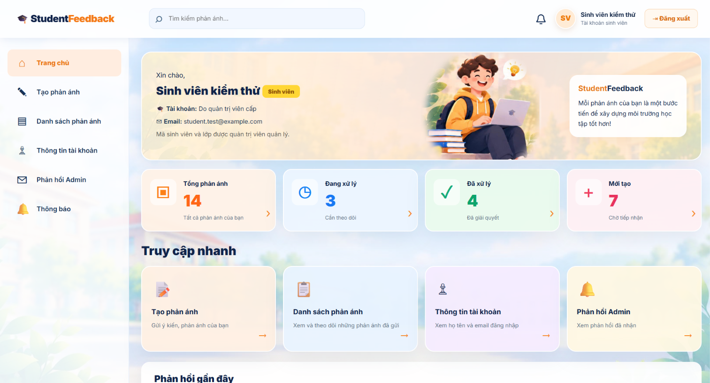
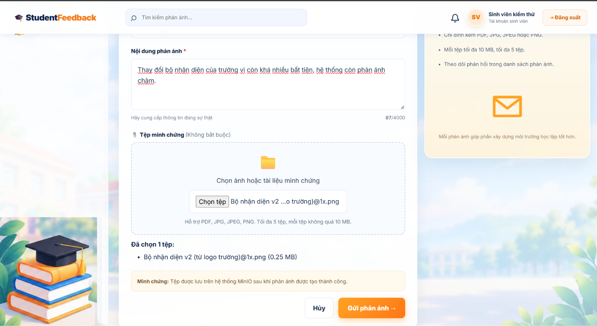
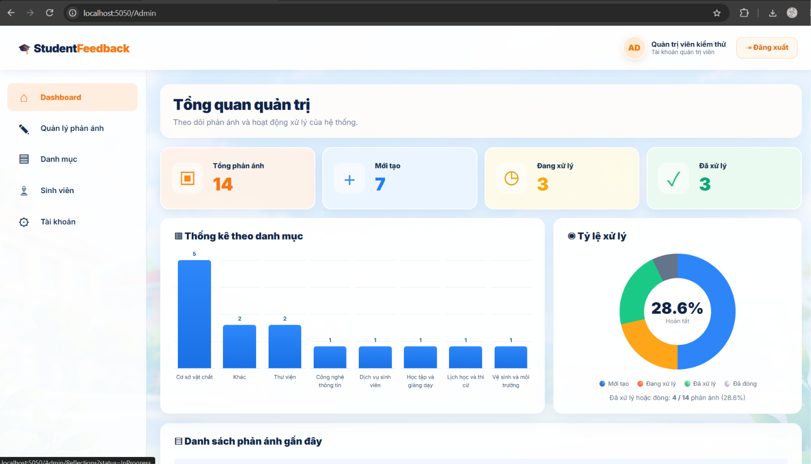
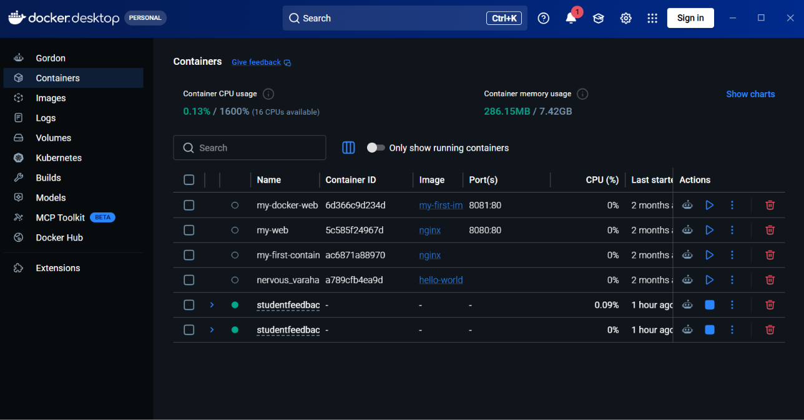

# StudentFeedback – Hệ thống quản lý phản ánh sinh viên

StudentFeedback là ứng dụng web giúp sinh viên gửi phản ánh, đính kèm minh chứng và theo dõi quá trình xử lý; đồng thời hỗ trợ quản trị viên tiếp nhận, phản hồi và quản lý phản ánh. Dự án được xây dựng cho đồ án cuối kỳ môn **Điện toán đám mây – Nhóm 5**, triển khai bằng Docker Compose.

## Tính năng chính

- **Sinh viên:** đăng nhập, xem hồ sơ, tạo phản ánh, chọn danh mục, tra cứu danh sách/trạng thái và xem phản hồi của quản trị viên.
- **Quản trị viên:** quản lý danh mục, phản ánh, phản hồi và các chức năng quản trị tài khoản theo phân quyền của hệ thống.
- **Tệp minh chứng:** tải lên tối đa **5 tệp/phản ánh**, mỗi tệp tối đa **10 MB**, hỗ trợ **PDF, JPG, JPEG, PNG**; nội dung tệp lưu trong **MinIO**, thông tin tệp lưu trong MariaDB.
- **Thông báo:** cung cấp trang thông báo sinh viên và chức năng đánh dấu đã đọc.
- **REST API:** hỗ trợ các nghiệp vụ quản lý dữ liệu; kiểm thử API qua Swagger/OpenAPI.
- **Triển khai container:** ứng dụng ASP.NET Core và MariaDB chạy qua Docker Compose, sử dụng mạng và volume Docker để kết nối, lưu trữ dữ liệu.

## Yêu cầu

- **Docker Desktop** (hoặc Docker Engine) và **Docker Compose**.
- **ASP.NET Core / .NET 9** (chỉ cần cài .NET SDK 9 nếu muốn chạy, build ngoài Docker).
- **MariaDB 10.4** để lưu dữ liệu nghiệp vụ.
- **MinIO Object Storage** để lưu tệp đính kèm.
- Trình duyệt web hiện đại; **Git** để tải và quản lý mã nguồn.

> **Lưu ý về kiến trúc hiện tại:** `docker-compose.yml` đang quản lý container **Web** và **MariaDB**; **MinIO** sử dụng container riêng tên `studentfeedback-minio`, tham gia mạng Docker ngoài `studentfeedback-shared`. Vì vậy, trên máy mới phải thiết lập MinIO và mạng này trước khi chạy toàn bộ hệ thống. Đề bài môn học yêu cầu có service MinIO trong Docker Compose; nhóm cần bổ sung cấu hình này vào bản nộp cuối kỳ hoặc cập nhật hướng dẫn theo cấu hình cuối cùng.

## Cài đặt và chạy

### 1. Tải mã nguồn

```bash
git clone https://github.com/KhangLN11/DoAnCuoiKy_CloudComputing_Nhom5.git
cd DoAnCuoiKy_CloudComputing_Nhom5/source-code/StudentFeedback
```

### 2. Chuẩn bị biến môi trường

Tạo tệp `.env` trong thư mục chứa `docker-compose.yml`. Nếu dự án đã có `.env.example`, sao chép tệp mẫu đó rồi điền giá trị phù hợp. Các biến đang sử dụng gồm:

```dotenv
DB_NAME=student_feedback_db
DB_USER=studentfeedback
DB_PASSWORD=change_this_password
DB_ROOT_PASSWORD=change_this_root_password
MINIO_ACCESS_KEY=change_this_access_key
MINIO_SECRET_KEY=change_this_secret_key
```

Các giá trị trên **chỉ là ví dụ**, không phải mật khẩu thật. Kiểm tra tên biến theo `docker-compose.yml` hiện tại; không commit `.env` lên GitHub. Nên tạo và đưa `.env.example` (chỉ có giá trị mẫu) vào repository trước khi nộp.

### 3. Khởi động MinIO và Docker Compose

Ở **máy đã được cấu hình MinIO như môi trường phát triển của nhóm**, mở Docker Desktop và chạy:

```bash
# Chạy một lần nếu mạng chưa tồn tại:
docker network create studentfeedback-shared

# Khởi động container MinIO đã được tạo từ trước:
docker start studentfeedback-minio

# Build và khởi động ứng dụng + MariaDB:
docker compose up -d --build

# Kiểm tra trạng thái:
docker compose ps
```

Nếu mạng đã tồn tại, **bỏ qua** lệnh `docker network create`. Nếu máy chưa có container `studentfeedback-minio`, cần thiết lập container MinIO và volume lưu trữ trước; lệnh `docker start` không tự tạo container mới.

### 4. Khởi tạo dữ liệu và kiểm tra hoạt động

Khi sử dụng máy mới hoặc volume MariaDB mới, cần khởi tạo cấu trúc và dữ liệu bằng bản SQL của nhóm (nếu được cung cấp) hoặc quy trình EF Core migration tương ứng. **Không đưa dữ liệu cá nhân hoặc file `.env` vào bản nộp công khai.** Trên máy phát triển đã import dữ liệu trước đó, không cần import lại mỗi lần chạy.

- **Website:** http://localhost:5050/
- **Swagger:** http://localhost:5050/swagger/index.html
- **Health API:** http://localhost:5050/api/v1/health
- **MinIO Console:** http://localhost:9001/

Khi chạy bình thường, `studentfeedback-db` có trạng thái `healthy`, `studentfeedback-web` có trạng thái `Up` và Health API trả về `Healthy`.

**Tài khoản demo:** 
Tài khoản sinh viên: student.test@example.com Mật khẩu: 123456789nhom5
Tài khoản Admin: admin.test@example.com Mật khẩu: 123456789admin.

### 5. Dừng và cập nhật ứng dụng

```bash
# Dừng các service do Docker Compose quản lý (giữ named volume):
docker compose down

# Khởi động lại:
docker compose up -d

# Build lại Web sau khi cập nhật mã nguồn:
docker compose up -d --build web
```

**Cảnh báo:** `docker compose down -v` sẽ xóa các named volume thuộc dự án Compose, có thể làm mất dữ liệu demo. **Chỉ sử dụng khi chủ động muốn xóa dữ liệu và đã sao lưu.** Container MinIO đang chạy riêng cần được quản lý riêng.

## Hướng dẫn sử dụng

1. Truy cập `http://localhost:5050/` và đăng nhập bằng tài khoản được nhóm cấp.
2. Với **sinh viên**, chọn **Tạo phản ánh**, nhập tiêu đề, danh mục, nội dung; có thể đính kèm tệp minh chứng theo giới hạn hệ thống.
3. Vào **Danh sách phản ánh** để tra cứu, xem chi tiết, tình trạng xử lý và phản hồi.
4. Sử dụng **chuông thông báo** hoặc **Thông tin tài khoản** trên thanh điều hướng để truy cập các trang tương ứng.
5. Với **quản trị viên**, đăng nhập bằng tài khoản có quyền Admin để tiếp nhận, xử lý phản ánh và quản lý các danh mục/chức năng được phân quyền.
6. Có thể dùng **Swagger** để kiểm thử REST API và **MinIO Console** để đối chiếu tệp đã lưu.


 -->

. -->

. -->

. -->

## Cấu trúc thư mục

```text
DoAnCuoiKy_CloudComputing_Nhom5/
└── source-code/
    └── StudentFeedback/
        ├── Controllers/          # MVC Controllers và REST API
        ├── Contracts/            # DTO và dữ liệu request
        ├── Data/                 # EF Core DbContext, cấu hình CSDL
        ├── Models/               # Model nghiệp vụ và ViewModel
        ├── Services/             # Xử lý dịch vụ, tích hợp MinIO
        ├── Views/                # Giao diện Razor
        ├── wwwroot/              # CSS, JavaScript, hình ảnh
        ├── Dockerfile            # Build ASP.NET Core image
        ├── docker-compose.yml    # Khai báo Web, MariaDB và mạng
        ├── .dockerignore         # Loại trừ file không cần khi build
        └── README.md             # Tài liệu dự án
```

- `docs/images/`: **thư mục dự kiến bổ sung** để lưu ảnh minh chứng; chưa mặc định có trong mã nguồn.
- `.env`: tệp cấu hình riêng của từng máy, **không đưa lên Git**.

## Thành viên


- **Lý Nguyên Khang** – Trưởng nhóm, điều phối và tích hợp (`MSSV: 24210501018`).
- **Võ Khải Toàn** – Giao diện và chức năng sinh viên (`MSSV: 24210501039`).
- **Lê Vũ Lực** – Giao diện quản trị, tiếp nhận và xử lý phản ánh (`MSSV: 24210501021`).
- **Lê Lâm Nhật Nam** – Xử lý nghiệp vụ và cơ sở dữ liệu (`MSSV: 24210501023`).
- **Nguyễn Hoàng Gia** – Kiểm thử và tài liệu hướng dẫn (`MSSV: 24210501013`).

## Giấy phép

Dự án được thực hiện phục vụ học tập cho môn **Điện toán đám mây**. **Nhóm chưa xác nhận giấy phép phát hành**, vì vậy không mặc định đây là mã nguồn được cấp phép sử dụng lại. 
